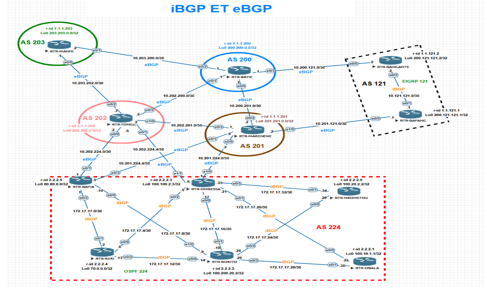

# 🌐 Routage Inter-Domaines & Intra-Domaine BGP Multi-AS (eBGP & iBGP)


-FF6F00?style=for-the-badge)


Conception, implémentation et validation d'une architecture réseau multi-systèmes autonomes (**6 AS interconnectés**) sous Cisco IOS et **EVE-NG**. Ce laboratoire met en œuvre le routage externe (**eBGP**) entre domaines autonomes de transit et périphériques, le routage interne (**iBGP**) au sein des AS multi-routeurs, ainsi que les protocoles IGP sous-jacents (**OSPF** et **EIGRP**) garantissant la connectivité et la résilience de bout en bout.

---

## 📑 Table des Matières

1. [Architecture & Topologie](#-architecture--topologie)
2. [Organisation des Systèmes Autonomes (AS)](#-organisation-des-systèmes-autonomes-as)
3. [Plan d'Adressage IP Complet](#-plan-dadressage-ip-complet)
4. [Mécanismes & Ingénierie BGP Déployés](#-mécanismes--ingénierie-bgp-déployés)
5. [Structure du Dépôt](#-structure-du-dépôt)
6. [Déploiement & Commandes de Vérification](#-déploiement--commandes-de-vérification)
7. [Auteur & Encadrement](#-auteur--encadrement)

---

## 📐 Architecture & Topologie



L'infrastructure regroupe **12 routeurs Cisco** répartis à travers **6 Systèmes Autonomes (AS)** :
* **4 AS mono-routeur (Transit / Périphérie) :** `AS 200`, `AS 201`, `AS 202`, `AS 203`.
* **2 AS multi-routeurs (Cœur d'opérateurs / Backbone) :** `AS 121` (2 routeurs) et `AS 224` (6 routeurs).

---

## 🏛️ Organisation des Systèmes Autonomes (AS)

| Système Autonome | Équipements | IGP Sous-jacent | Rôle & Interconnexions |
| :---: | :--- | :---: | :--- |
| **AS 203** | `RTR-MANFE` | — | AS périphérique connecté en **eBGP** à `AS 200` et `AS 202`. |
| **AS 200** | `RTR-BATIE` | — | AS de transit central connecté en **eBGP** à `AS 203`, `AS 202`, `AS 201` et `AS 121`. |
| **AS 202** | `RTR-TONGA` | — | AS de transit connecté en **eBGP** à `AS 203`, `AS 200`, `AS 201` et `AS 224` (via `RTR-BAFIA` et `RTR-OMBESSA`). |
| **AS 201** | `RTR-MAKENENE` | — | AS de transit connecté en **eBGP** à `AS 200`, `AS 202`, `AS 121` et `AS 224` (via `RTR-BAFIA` et `RTR-OMBESSA`). |
| **AS 121** | `RTR-BANGANTE`, `RTR-BAFANG` | **EIGRP 121** | AS multi-routeurs exécutant **iBGP** entre ses deux nœuds et **eBGP** vers `AS 200` et `AS 201`. |
| **AS 224** | `RTR-BAFIA`, `RTR-OMBESSA`, `RTR-KIIKI`, `RTR-BOKITO`, `RTR-NKOMETOU`, `RTR-OBALA` | **OSPF 224** | Backbone maillé exécutant **iBGP** sur interfaces Loopback et **eBGP** multi-homing vers `AS 202` et `AS 201`. |

---

## 📊 Plan d'Adressage IP Complet

### 1. Identifiants BGP et Interfaces Loopback (`Lo0`)

| AS | Routeur | Router-ID (`r-id`) | Loopback 0 (`Lo0`) | Rôle BGP |
| :---: | :--- | :---: | :---: | :--- |
| **AS 203** | `RTR-MANFE` | `1.1.1.203` | `203.203.0.0/32` | eBGP Speaker |
| **AS 200** | `RTR-BATIE` | `1.1.1.200` | `200.200.0.0/32` | eBGP Speaker |
| **AS 202** | `RTR-TONGA` | `1.1.1.202` | `202.202.0.0/32` | eBGP Speaker |
| **AS 201** | `RTR-MAKENENE` | `1.1.1.201` | `201.201.0.0/32` | eBGP Speaker |
| **AS 121** | `RTR-BANGANTE` | `1.1.121.2` | `200.121.121.2/32` | eBGP (`AS 200`) / iBGP |
| **AS 121** | `RTR-BAFANG` | `1.1.121.1` | `200.121.121.1/32` | eBGP (`AS 201`) / iBGP |
| **AS 224** | `RTR-BAFIA` | `2.2.2.5` | `80.80.0.0/32` | eBGP (`AS 202`, `AS 201`) / iBGP |
| **AS 224** | `RTR-OMBESSA` | `2.2.2.3` | `100.100.2.3/32` | eBGP (`AS 202`, `AS 201`) / iBGP |
| **AS 224** | `RTR-KIIKI` | `2.2.2.4` | `70.0.0.0/32` | iBGP Core |
| **AS 224** | `RTR-BOKITO` | `2.2.2.2` | `100.200.20.2/32` | iBGP Core |
| **AS 224** | `RTR-NKOMETOU` | `2.2.2.0` | `100.20.2.2/32` | iBGP Core |
| **AS 224** | `RTR-OBALA` | `2.2.2.1` | `100.10.1.1/32` | iBGP Core |

### 2. Liens d'Interconnexion Externe (eBGP — `/30`)

* **Entre AS 203, AS 200, AS 202 et AS 201 :**
  * `RTR-MANFE` (`e0/1`) $\leftrightarrow$ `RTR-BATIE` (`e0/2`) : `10.203.200.0/30` (`.1` / `.2`)
  * `RTR-MANFE` (`e0/0`) $\leftrightarrow$ `RTR-TONGA` (`e0/2`) : `10.203.202.0/30` (`.1` / `.2`)
  * `RTR-BATIE` (`e0/1`) $\leftrightarrow$ `RTR-TONGA` (`e0/3`) : `10.202.200.0/30` (`.1` / `.2`)
  * `RTR-BATIE` (`e0/0`) $\leftrightarrow$ `RTR-MAKENENE` (`e0/2`) : `10.200.201.0/30` (`.1` / `.2`)
  * `RTR-TONGA` (`e1/0`) $\leftrightarrow$ `RTR-MAKENENE` (`e0/3`) : `10.202.201.0/30` (`.2` / `.1`)
* **Vers AS 121 :**
  * `RTR-BATIE` (`e0/3`) $\leftrightarrow$ `RTR-BANGANTE` (`e0/0`) : `10.200.121.0/30` (`.1` / `.2`)
  * `RTR-MAKENENE` (`e1/0`) $\leftrightarrow$ `RTR-BAFANG` (`e0/0`) : `10.201.121.0/30` (`.2` / `.1`)
* **Vers AS 224 (Multi-Homing) :**
  * `RTR-TONGA` (`e0/0`) $\leftrightarrow$ `RTR-BAFIA` (`e0/1`) : `10.202.224.0/30` (`.2` / `.1`)
  * `RTR-TONGA` (`e0/1`) $\leftrightarrow$ `RTR-OMBESSA` (`e1/1`) : `10.202.224.4/30` (`.5` / `.6`)
  * `RTR-MAKENENE` (`e0/1`) $\leftrightarrow$ `RTR-BAFIA` (`e0/3`) : `10.201.224.4/30` (`.6` / `.5`)
  * `RTR-MAKENENE` (`e0/0`) $\leftrightarrow$ `RTR-OMBESSA` (`e1/0`) : `10.201.224.0/30` (`.2` / `.1`)

### 3. Liens Internes (iBGP & IGP — `/30`)

* **Interne AS 121 (EIGRP 121) :**
  * `RTR-BANGANTE` (`e0/2`) $\leftrightarrow$ `RTR-BAFANG` (`e0/1`) : `10.121.121.0/30` (`.2` / `.1`)
* **Interne AS 224 (OSPF 224) :**
  * `RTR-BAFIA` (`e0/2`) $\leftrightarrow$ `RTR-KIIKI` (`e0/1`) : `172.17.17.0/30` (`.1` / `.2`)
  * `RTR-KIIKI` (`e0/0`) $\leftrightarrow$ `RTR-OMBESSA` (`e0/2`) : `172.17.17.4/30` (`.6` / `.5`)
  * `RTR-BAFIA` (`e0/0`) $\leftrightarrow$ `RTR-BOKITO` (`e1/0`) : `172.17.17.8/30` (`.10` / `.9`)
  * `RTR-KIIKI` (`e0/2`) $\leftrightarrow$ `RTR-BOKITO` (`e0/0`) : `172.17.17.12/30` (`.13` / `.14`)
  * `RTR-OMBESSA` (`e0/0`) $\leftrightarrow$ `RTR-BOKITO` (`e0/1`) : `172.17.17.16/30` (`.17` / `.18`)
  * `RTR-OMBESSA` (`e0/1`) $\leftrightarrow$ `RTR-OBALA` (`e0/0`) : `172.17.17.20/30` (`.21` / `.22`)
  * `RTR-BOKITO` (`e0/2`) $\leftrightarrow$ `RTR-NKOMETOU` (`e0/0`) : `172.17.17.24/30` (`.25` / `.26`)
  * `RTR-BOKITO` (`e0/3`) $\leftrightarrow$ `RTR-OBALA` (`e0/1`) : `172.17.17.28/30` (`.29` / `.30`)
  * `RTR-OMBESSA` (`e0/3`) $\leftrightarrow$ `RTR-NKOMETOU` (`e0/1`) : `172.17.17.32/30` (`.33` / `.34`)

---

## ⚙️ Mécanismes & Ingénierie BGP Déployés

* **Sessions eBGP :** Établies directement sur les adresses physiques point-à-point (`/30`) entre routeurs de bordure d'AS distincts.
* **Sessions iBGP & Résilience :**
  * Établies via les interfaces de bouclage (**`update-source Loopback0`**) au sein de `AS 121` et `AS 224` afin de maintenir les sessions actives tant qu'un chemin IGP valide existe.
  * Activation systématique de **`next-hop-self`** sur les routeurs de bordure (`RTR-BANGANTE`, `RTR-BAFANG`, `RTR-BAFIA`, `RTR-OMBESSA`) pour garantir l'accessibilité du prochain saut eBGP à l'intérieur des AS internes.
  * Désactivation de la synchronisation BGP (`no synchronization`) et du résumé automatique (`no auto-summary`).
* **Routage Sous-Jacent (IGP) :**
  * **EIGRP AS 121** sur `RTR-BANGANTE` et `RTR-BAFANG` pour annoncer leurs Loopbacks et le lien interne `10.121.121.0/30`.
  * **OSPF Process 224 (Area 0)** sur les 6 routeurs de `AS 224` pour assurer la convergence rapide du maillage interne `172.17.17.0/24` et l'accessibilité des Loopbacks (`Lo0`).

---

## 📁 Structure du Dépôt

```text
├── README.md                  # Documentation complète de l'architecture BGP
├── topologie.png              # Schéma détaillé de l'interconnexion multi-AS (eBGP / iBGP)
└── configs/                   # Configurations Cisco IOS (.cfg) classées par Système Autonome
    ├── AS121/
    │   ├── RTR-BANGANTE.cfg   # Routeur bordure AS 121 (eBGP AS 200, iBGP, EIGRP 121)
    │   └── RTR-BAFANG.cfg     # Routeur bordure AS 121 (eBGP AS 201, iBGP, EIGRP 121)
    ├── AS200/
    │   └── RTR-BATIE.cfg      # Routeur transit AS 200 (eBGP AS 203, 202, 201, 121)
    ├── AS201/
    │   └── RTR-MAKENENE.cfg   # Routeur transit AS 201 (eBGP AS 200, 202, 121, 224)
    ├── AS202/
    │   └── RTR-TONGA.cfg      # Routeur transit AS 202 (eBGP AS 203, 200, 201, 224)
    ├── AS203/
    │   └── RTR-MANFE.cfg      # Routeur périphérique AS 203 (eBGP AS 200, 202)
    └── AS224/
        ├── RTR-BAFIA.cfg      # Routeur bordure AS 224 (eBGP AS 202, 201, iBGP, OSPF 224)
        ├── RTR-OMBESSA.cfg    # Routeur bordure AS 224 (eBGP AS 202, 201, iBGP, OSPF 224)
        ├── RTR-KIIKI.cfg      # Routeur cœur AS 224 (iBGP, OSPF 224)
        ├── RTR-BOKITO.cfg     # Routeur cœur AS 224 (iBGP, OSPF 224)
        ├── RTR-NKOMETOU.cfg   # Routeur cœur AS 224 (iBGP, OSPF 224)
        └── RTR-OBALA.cfg      # Routeur cœur AS 224 (iBGP, OSPF 224)
